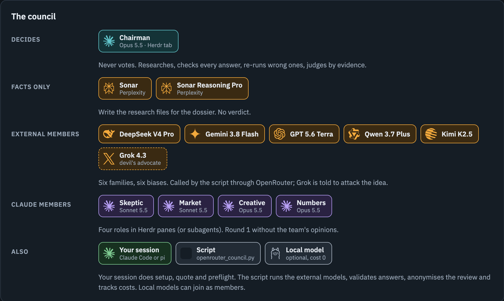

# idea-council

I fed a 23k-character brief about my Christmas campaign (who we are, past results, numbers, fears, 9 questions) to a council of 10 LLMs. I thought the plan was right. They took it apart, fact by fact, for about $1.10.

`idea-council` is an agent skill that puts any idea, plan or project in front of a council that does not agree by default: a business idea, a campaign, a pricing change, a hiring plan, an architecture choice, anything complex enough to deserve more than one opinion. Facts first, numbers from a script, a blind round before anyone sees your opinions, an anonymous peer review, and a chairman that re-runs any model that gets it wrong.

It works in Claude Code, Codex, pi and any agent that reads `SKILL.md` files.



## What you get

- A **fact dossier**: ~30 facts with source URL, date, confidence and a *claimed vs measured* tag.
- **Numbers that no model can bend**: a deterministic script computes the economics (the template ships break-even ROAS, max CPA and pessimistic / base / optimistic scenarios; the chairman adapts it to your case) and models may cite them, never change them.
- **10 independent opinions** (6 OpenRouter models of different families, Grok as devil's advocate, 4 Claude roles: skeptic, market, creative, numbers), each answering every question with evidence for, evidence against, "fails if…", a verdict and the cheapest test with a kill criterion.
- A **sycophancy test**: round 1 is blind to your opinions, round 2 is not. Whoever changes verdict without a new fact gets reported.
- A **report** of at most one page per question, verdict first, written by an Opus 5.5 chairman that judges by evidence, not by vote count.

## How a run goes

1. You write `idea.md` and type `/idea-council idea.md`.
2. First run only: a short interactive setup (where your OpenRouter key file is, AIsa yes/no, Herdr / subagents / local models, how many models, who plays devil's advocate).
3. You get a **quote** with the exact model ids and a dollar range. One confirmation, then nothing else is asked.
4. The chairman (Opus 5.5 in Claude Code, your host's best model elsewhere) opens in its own tab or takes over the session, and drives the dossier, the two rounds, the review and the verdict. Every answer is validated; wrong ones are re-run with a note.
5. `report.md` lands in `llm-council/<date>-<slug>/` with the full audit trail (every answer, every cost).

A step-by-step page of the flow is in [`docs/flow.html`](docs/flow.html).

## Install

With the [skills CLI](https://skills.sh) (installs into every agent it finds):

```sh
npx skills add pavelux00x/idea-council -g
```

Or clone it into your agent's skills folder:

```sh
# Claude Code
git clone https://github.com/pavelux00x/idea-council.git ~/.claude/skills/idea-council
# Codex
git clone https://github.com/pavelux00x/idea-council.git ~/.codex/skills/idea-council
# pi
git clone https://github.com/pavelux00x/idea-council.git ~/.pi/agent/skills/idea-council
# any other agent: the folder that holds its SKILL.md skills, or a symlink to one clone
```

Requirements: Python 3 (standard library only) and an [OpenRouter](https://openrouter.ai) key in a file of your choice. Optional: [Herdr](https://herdr.app) for visible agent tabs (without it the current session acts as chairman and the four role members run as your host's subagents, or are skipped), [AIsa](https://aisa.one) for extra online research, local models through any OpenAI-compatible server (Ollama, LM Studio).

The skill never reads or prints your key: you give it the **path** of the file, and only the Python script opens it to call OpenRouter.

## Cost

The pastry run above: 9 questions, 753k tokens, $0.66 on OpenRouter plus $0.07 of Reddit searches with the previous model set. With the current defaults (web search in round 1, GPT 5.6 Terra, two Perplexity researchers) expect about $0.9-1.5 per run; the quote tells you before you spend. Claude runs on your Claude Code plan.

## Files

| file | role |
|---|---|
| `SKILL.md` | the skill: phases, actors, rules, report template |
| `openrouter_council.py` | quote, model catalog, runs the external models, validates answers, anonymises the review, tracks costs |
| `calc_template.py` | the deterministic numbers (e-commerce economics by default, adapt per case) |
| `eval_run.py` | nine sanity checks on a finished run |
| `config.example.json` | copy to `~/.config/idea-council/config.json` |

Inspired by [karpathy/llm-council](https://github.com/karpathy/llm-council).

MIT License.
